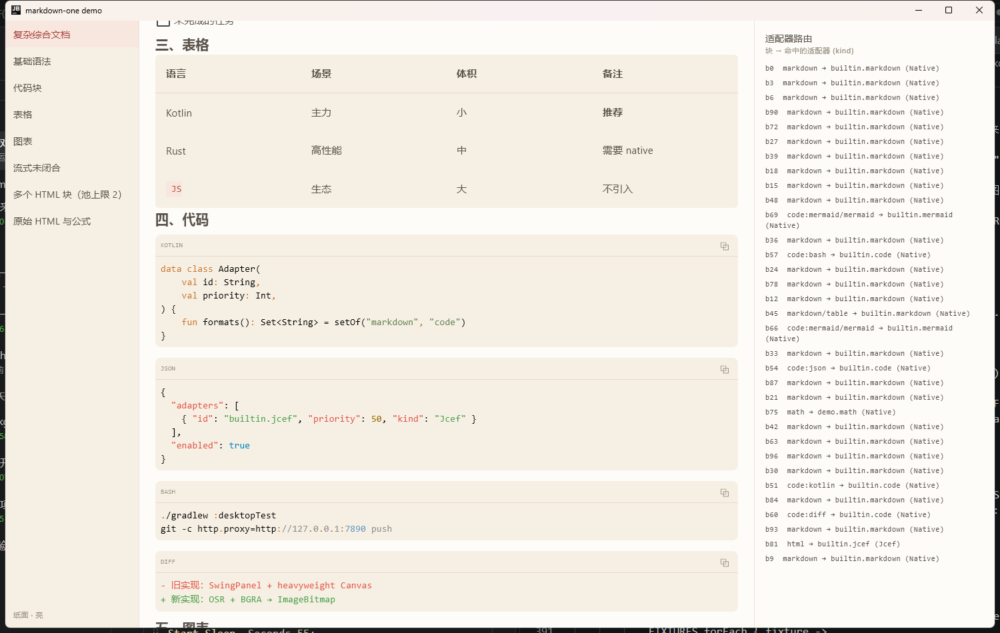

# markdown-one

[](https://github.com/Shinglem/markdown-one/actions/workflows/build.yml)
[](LICENSE)
[](https://kotlinlang.org)
[](https://www.jetbrains.com/lp/compose-multiplatform/)

面向 Compose Multiplatform 的 Markdown 渲染组件：**解析 → 块 → 适配器 → 渲染**，
一条能力不足就降级下一级，最后兜底成源码 —— 永远不会留一块空白。

**目标多端，当前只实现 desktop（JVM）。**



<sub>左侧 fixture 列表、中间渲染结果、右侧实时适配器路由 —— 就是 demo 本身。</sub>

## 特性

- **块级适配器链**：每种内容类型（代码、图表、公式、原始 HTML、表格…）独立路由到最合适的渲染器，
  失败只影响那一块。见 [架构](docs/architecture.md)。
- **可替换**：调用方通过 `MarkdownConfig.adapters` 覆盖任何内置实现，或用
  `META-INF/services` 让独立 artifact 自动生效。见 [写适配器](docs/adapters.md)。
- **永远有东西看**：没有合适渲染器时显示源码，而不是空白或一串异常。
- **原生优先、不引 WebView**：代码高亮、表格、列表、图表（Mermaid / PlantUML / DOT）、公式（RaTeX）、
  原始 HTML（ksoup 清洗后按标签语义渲染）全部是 Compose 绘制。
- **流式友好**：未闭合栅栏自动补齐；流式期间图表只占位不出图，避免每帧重排把滚动抖掉。
- **大块可用**：限高 + 双向滚动条 + 百分比缩放档位。
- **外观可换**：内置暖白纸面主题，明暗两套色板。

## 状态

| 项 | 状态 |
|---|---|
| desktop（JVM） | ✅ 可用 |
| Android / iOS / Web | 结构已预留（见 [多端](#多端)），未实现 |
| 发布 | 未发布到 Maven Central；当前以 git submodule 或本地构建接入 |

## 快速开始

```kotlin
dependencies {
    // 以 git submodule 挂在 :modules/markdown-one 时的写法
    implementation(project(":modules:markdown-one"))
}
```

```kotlin
MarkdownText(
    markdown = text,
    streaming = isAnswering,   // 流式：图表先占位，未闭合栅栏会被补齐
    config = MarkdownConfig(), // 适配器、主题、视口、诊断
)
```

需要纸面外观：

```kotlin
MarkdownText(markdown, config = MarkdownConfig(theme = outsidePaperTheme(dark = isDark)))
```

跑起来看效果：

```bash
./gradlew :demo:run
```

## 为什么是「适配器」

Markdown 里塞得下代码、图表、公式、原始 HTML —— 它们的渲染手段完全不同，
但调用方只想调一个 `MarkdownText`。

于是每种内容类型先被解析成块（`MdBlock`），再按 **格式** 向适配器链要渲染器：

```
MdBlock ──► AdapterRegistry
              ├── NativeAdapter (priority 100)  纯 Compose 绘制
              └── SourceFallback(priority   0)  源码 + 提示，永不留空白
```

- **一个适配器可以声明多种格式**（`formats(): Set<FormatId>`），也支持前缀通配（`code:*`）。
- **自动发现**：可选 artifact 通过 `META-INF/services` 登记 `BlockAdapterFactory`，存在即启用。
- **显式注册优先**：`MarkdownConfig.adapters` 可覆盖/禁用内置适配器。
- **两条纪律**：禁止静默替换（画不出就走下一级并留可见痕迹）；流式期间只降不升（图表先占位）。

内置适配器：

| id | 格式 | 实现 |
|---|---|---|
| `builtin.markdown` | `markdown` | 自研文本块渲染器：标题 / 段落 / 引用 / 列表 / 表格 / 分割线 |
| `builtin.code` | `code:*` | `syntaxmp-tokenizer` + Highlights + 9 组正则补丁 |
| `builtin.diagram` | `mermaid` / `code:*` | `io.github.huarangmeng:diagram-render`：Mermaid / PlantUML / DOT |
| `builtin.footnotes` | `footnotes` | 脚注定义区（解析前抽出的定义，文末按序号渲染） |
| `builtin.math` | `math` | `io.github.darriousliu:ratex`（仅 desktop） |
| `builtin.html.native` | `html` | ksoup 清洗 → Compose 块树（GitHub 白名单） |
| `builtin.html` / `builtin.details` | `html` / `details` | 剥壳后递归交回 `MarkdownText`（原生渲染的兜底） |
| `builtin.source` | `*` | 源码兜底 |

## 文档

| 文档 | 内容 |
|---|---|
| [架构](docs/architecture.md) | 渲染链路、块模型、路由规则、线程与生命周期 |
| [写适配器](docs/adapters.md) | SPI 语义、注册方式、自定义块、视口、诊断 |
| [API 参考](docs/api.md) | `MarkdownText` / `MarkdownConfig` / `BlockViewportConfig` / `MdBlock` / 主题 |
| [常见问题](docs/faq.md) | 显示成源码、图表画不出、空白帧、滚动条、性能 |
| [路线图](docs/roadmap.md) | 正在进行、接下来、明确不做的事 |
| [贡献指南](CONTRIBUTING.md) | 环境、自检清单、代码风格、提交规范、加 target |
| [变更日志](CHANGELOG.md) | 版本历史与已知问题 |
| [安全策略](SECURITY.md) | 威胁模型：不可信 Markdown、HTML 白名单、原生依赖 |

## 开发

```bash
./gradlew :desktopTest   # 单元测试
./gradlew :demo:run      # sandbox
./gradlew build          # 全量构建

# 指定启动时选中的 fixture（序号或名称）
./gradlew :demo:run -Pfixture=0


# 大块的初始缩放（验证横向滚动条）与正文初始滚动位置
./gradlew :demo:run -Pzoom=1.5 -Pscroll=760
```

demo 左侧是 fixture 列表，右侧「适配器路由」实时显示**每个块命中的适配器**，
是这套架构最有效的自检工具。

| # | fixture | 用来检查 |
|---|---|---|
| 0 | 复杂综合文档 | 标题（含 setext）、行内格式、嵌套列表与任务列表、表格、四种语言代码块、flowchart 与 sequence 图、公式、原始 HTML、嵌套引用、分割线、长段落 |
| 1 | 基础语法 | 行内排版与段落间距 |
| 2 | 代码块 | 高亮、语言标签、复制按钮 |
| 3 | 表格 | 视口限高与横向滚动 |
| 4 | 图表 | Mermaid / PlantUML / DOT 三类图 |
| 5 | 流式未闭合 | 未闭合栅栏补齐、图表占位 |
| 6 | HTML 原生渲染 | 标签语义、白名单、`<script>` 不显示 |
| 7 | 图表与 PlantUML | 三类图各一个样本 |
| 8 | 原始 HTML 与公式 | 原生 HTML + 公式混排 |

`-Pfixture` / `-Pzoom` / `-Pscroll` 也接受环境变量 `DEMO_FIXTURE` / `DEMO_ZOOM` / `DEMO_SCROLL`
（Gradle 会累积 `jvmArgs`，同一次 daemon 里反复换 `-P` 值不一定生效，截图脚本用环境变量更稳）。

## 构建契约（改动前务必先读）

本仓库会被宿主工程以 **git submodule** 挂载（宿主 `include(":modules:markdown-one")`），
那时本仓库的 `settings.gradle.kts` 不生效，`libs` 指向宿主的 version catalog。因此：

1. **target 名保持 `jvm("desktop")`**：同一构建内的 KMP project 依赖要求 target 名对齐，
   改成标准 `jvm()` 会让宿主变体不匹配。多端化时需与宿主同步改。
2. **`jvmTarget = JVM_25`**，与宿主一致。
3. **插件用 version catalog alias，依赖坐标用 `build.gradle.kts` 里的字面量**
   —— 宿主 toml 里没有的 catalog 条目会让脚本在宿主构建里直接报错。
4. **发布插件用 `id("maven-publish")`**（builtin，无版本），不要用 alias。
5. **镜像按属性切换**：本机默认 `mirror=cn`（腾讯云 → 阿里云 → central 兜底）；
   CI 传 `-Pmirror=off` 只用官方源，避免境外构建机撞国内镜像超时。

## 多端

全部逻辑在 `commonMain`，只有两处平台差异：

- `discoverAdapterFactories()` 是 `expect/actual`：JVM 用 `ServiceLoader`，
  其它端返回空列表（靠 `MarkdownConfig.adapters` 显式注册）。
- 公式适配器（`ratex`，含 native dll）只在 `desktopMain`；其它端落到 `builtin.source` 显示 TeX 源码。

`LRU` 缓存等 JVM 专有实现也集中在 `desktopMain`，加 target 时按平台各写一份。
具体步骤见 [CONTRIBUTING · 加一个 target](CONTRIBUTING.md#加一个-target)。

## 目录

```
markdown-one/
├── build.gradle.kts        ← 核心库（KMP）
├── src/commonMain/         ← 模型 / 解析 / 适配器 SPI / 内置适配器 / 主题 / 视口
├── src/desktopMain/        ← ServiceLoader 发现、公式适配器、原生滚动条
├── src/commonTest/         ← 单元测试
├── demo/                   ← Compose Desktop sandbox
├── docs/                   ← 架构 / 适配器 / API / FAQ
└── .github/                ← CI、issue 与 PR 模板
```

## 依赖

| 用途 | 坐标 | 版本 |
|---|---|---|
| GFM 解析 | `org.jetbrains:markdown` | 0.7.17 |
| 代码高亮（主） | `com.gallatinapps.syntaxmp:syntaxmp-tokenizer` | 0.3.0 |
| 代码高亮（兜底） | `dev.snipme:highlights` | 1.1.0 |
| 图片 | `io.coil-kt.coil3:coil-compose` / `coil-svg` | 3.6.3 |
| 图表（Mermaid / PlantUML / DOT） | `io.github.huarangmeng:diagram-render` | 1.0.6 |
| HTML 解析 | `com.fleeksoft.ksoup:ksoup` | 0.2.6 |
| 公式 | `io.github.darriousliu:ratex`（仅 desktop） | 0.1.15 |

文本与块的渲染（标题、段落、引用、列表、表格、分割线、行内格式）全部由本库 `text/` 包实现，
**不依赖任何第三方 markdown renderer**。

### 代码高亮的语言扩展

主引擎是 `syntaxmp-tokenizer`（**只依赖 kotlin-stdlib**，不带 Compose，与 CMP 版本无关）。
它没有的语言用 `LanguageExtension` 在 `CodeHighlight.kt` 里注册，**不改依赖源码**：

| 扩展 id | 别名 | 规则 |
|---|---|---|
| `bat` | `bat` / `batch` / `cmd` | 行注释、标签、变量、关键字 |
| `vue` | `vue` / `xaml` / `svg` | 标签、属性、字符串、`{{ }}` 插值与 XAML 绑定 |
| `cfg` | `cfg` / `conf` | INI 规则 |
| `jsonc` | `jsonc` / `json5` | JSON + `//` 注释 |
| `scala` | `scala` | 关键字、类型、注解、字符串 |
| `lua` | `lua` | 长注释、关键字、内置函数、库名 |

加一门新语言只要写一组 `CodeRule` 再在 `SYNTAX_MP` 的 `extensions` 里加一行；
**扩展优先于内置**，所以也能覆盖内置语言的行为。`dev.snipme:highlights` 只留
`coffee` / `perl` 两个极低频语言兜底。

版本只在 `build.gradle.kts` 顶部出现一次，改版本时同步这张表。
`ratex` 的 native 部分由 `ratex-native-windows-x86-64` 提供（`runtimeOnly`，dll 打在 jar 里由库自己解压）。

## 能力边界

这些是刻意的取舍，不是待修 bug：

| 内容 | 做法 |
|---|---|
| HTML 嵌入 | 白名单标签按语义原生渲染；布局级 CSS、脚本、iframe 一律忽略 |
| 数学公式 | `ratex` 按 KaTeX 语法集排版；`\ce{}` / `\SI{}` 这类扩展包不支持（与 GitHub 一致） |
| 冷门图族 | 画不出时显示源码 + 提示（`mermaidFallbackText`），不做静默替换 |
| 社交卡片 / 远程内嵌 | 不做，显示为链接 |

更多排查路径见 [常见问题](docs/faq.md)。

## 许可证

[Apache-2.0](LICENSE)。
