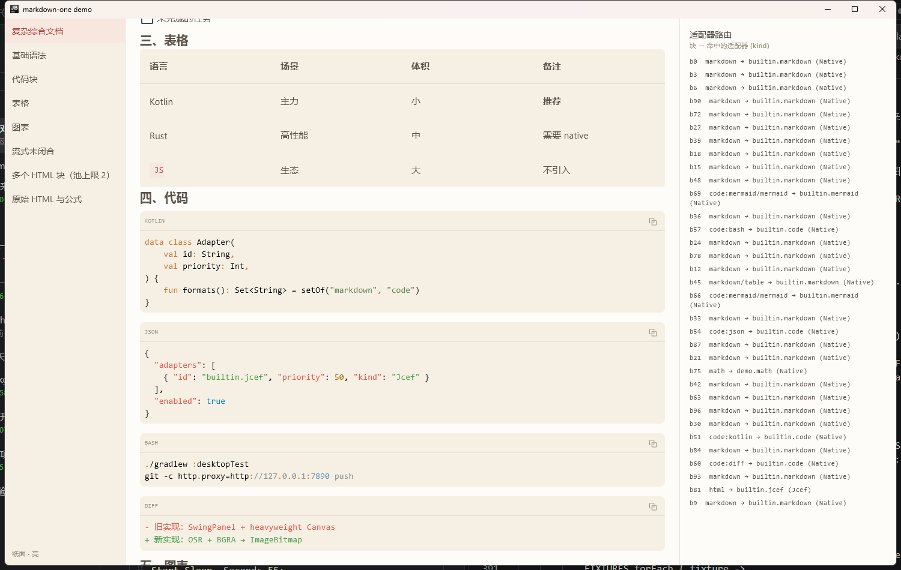

# markdown-one

[](https://github.com/Shinglem/markdown-one/actions/workflows/build.yml)
[](LICENSE)
[](https://kotlinlang.org)
[](https://www.jetbrains.com/lp/compose-multiplatform/)

面向 Compose Multiplatform 的 Markdown 渲染组件：**解析 → 块 → 适配器 → 渲染**，
一条能力不足就降级下一级，最后兜底成源码 —— 永远不会留一块空白。

**目标多端，当前只实现 desktop（JVM）。**



<sub>左侧 fixture 列表、中间渲染结果、右侧实时适配器路由 —— 就是 demo 本身。</sub>

## 特性

- **块级适配器链**：每种内容类型（代码、图表、公式、原始 HTML、表格…）独立路由到最合适的渲染器，
  失败只影响那一块。见 [架构](docs/architecture.md)。
- **可替换**：调用方通过 `MarkdownConfig.adapters` 覆盖任何内置实现，或用
  `META-INF/services` 让独立 artifact 自动生效。见 [写适配器](docs/adapters.md)。
- **永远有东西看**：没有合适渲染器时显示源码，而不是空白或一串异常。
- **原生优先**：代码高亮、表格、列表、图表（纯 Kotlin mermaid 引擎）都是 Compose 绘制，不引 WebView。
- **JCEF 回落（可选）**：真正需要浏览器时（KaTeX、完整 mermaid 语法、任意 HTML），
  用 OSR 离屏渲染接进来。库对 `org.cef.*` **零编译期依赖**，普通 JDK 照常构建。
  见 [JCEF](docs/jcef.md)。
- **流式友好**：未闭合栅栏自动补齐；流式期间浏览器类适配器自动让位，避免每帧重载。
- **大块可用**：限高 + 双向滚动条 + 百分比缩放档位；浏览器实例按可见性分配，长文档也只驻留 1–2 个进程。
- **外观可换**：内置暖白纸面主题，明暗两套色板。

## 状态

| 项 | 状态 |
|---|---|
| desktop（JVM） | ✅ 可用 |
| Android / iOS / Web | 结构已预留（见 [多端](#多端)），未实现 |
| 发布 | 未发布到 Maven Central；当前以 git submodule 或本地构建接入 |

## 快速开始

```kotlin
dependencies {
    // 以 git submodule 挂在 :modules/markdown-one 时的写法
    implementation(project(":modules:markdown-one"))
}
```

```kotlin
MarkdownText(
    markdown = text,
    streaming = isAnswering,   // 流式：图表先占位，未闭合栅栏会被补齐
    config = MarkdownConfig(), // 适配器、主题、视口、诊断
)
```

需要纸面外观：

```kotlin
MarkdownText(markdown, config = MarkdownConfig(theme = outsidePaperTheme(dark = isDark)))
```

跑起来看效果：

```bash
./gradlew :demo:run
```

## 为什么是「适配器」

Markdown 里塞得下代码、图表、公式、原始 HTML —— 它们的渲染手段完全不同，
但调用方只想调一个 `MarkdownText`。

于是每种内容类型先被解析成块（`MdBlock`），再按 **格式** 向适配器链要渲染器：

```
MdBlock ──► AdapterRegistry
              ├── NativeAdapter (priority 100)  纯 Compose 绘制
              ├── JcefAdapter   (priority  50)  内嵌浏览器离屏渲染（反射接入，零编译期依赖）
              └── SourceFallback(priority   0)  源码 + 提示，永不留空白
```

- **一个适配器可以声明多种格式**（`formats(): Set<FormatId>`），也支持前缀通配（`code:*`）。
- **自动发现**：可选 artifact 通过 `META-INF/services` 登记 `BlockAdapterFactory`，存在即启用。
- **显式注册优先**：`MarkdownConfig.adapters` 可覆盖/禁用内置适配器。
- **两条纪律**：禁止静默替换（画不出就走下一级并留可见痕迹）；流式期间只降不升（JCEF 不参与）。

内置适配器：

| id | 格式 | 实现 |
|---|---|---|
| `builtin.markdown` | `markdown` | mikepenz 的 element composable |
| `builtin.code` | `code:*` | Highlights + 8 组正则补丁 |
| `builtin.mermaid` | `mermaid` / `code:mermaid` | `io.github.swithun-liu:mermaid-compose`（纯 Kotlin，无 WebView） |
| `builtin.jcef` | `html` / `math` / `mermaid` | JCEF OSR（仅 desktop，`webFallback = Jcef` 时注册） |
| `builtin.source` | `*` | 源码兜底 |

## 文档

| 文档 | 内容 |
|---|---|
| [架构](docs/architecture.md) | 渲染链路、块模型、路由规则、线程与生命周期 |
| [写适配器](docs/adapters.md) | SPI 语义、注册方式、自定义块、视口、诊断 |
| [JCEF 回落](docs/jcef.md) | 运行环境、开关、六个静默失败的坑、名额与生命周期、安全 |
| [API 参考](docs/api.md) | `MarkdownText` / `MarkdownConfig` / `BlockViewportConfig` / `MdBlock` / 主题 |
| [常见问题](docs/faq.md) | 显示成源码、图表画不出、空白帧、滚动条、性能 |
| [贡献指南](CONTRIBUTING.md) | 环境、自检清单、代码风格、提交规范、加 target |
| [变更日志](CHANGELOG.md) | 版本历史与已知问题 |

## 开发

```bash
./gradlew :desktopTest   # 单元测试
./gradlew :demo:run      # sandbox
./gradlew build          # 全量构建

# 指定启动时选中的 fixture（序号或名称）
./gradlew :demo:run -Pfixture=0

# 用 JBR with JCEF 跑（自动加 --add-modules jcef 等参数），验证 JCEF 回落
./gradlew :demo:run -PjbrHome="C:\path\to\jbrsdk_jcef" -Pfixture=6

# 大块的初始缩放（验证横向滚动条）与正文初始滚动位置
./gradlew :demo:run -Pzoom=1.5 -Pscroll=760
```

demo 左侧是 fixture 列表，右侧「适配器路由」实时显示**每个块命中的适配器**，
是这套架构最有效的自检工具。

| # | fixture | 用来检查 |
|---|---|---|
| 0 | 复杂综合文档 | 标题（含 setext）、行内格式、嵌套列表与任务列表、表格、四种语言代码块、flowchart 与 sequence 图、公式、原始 HTML、嵌套引用、分割线、长段落 |
| 1 | 基础语法 | 行内排版与段落间距 |
| 2 | 代码块 | 高亮、语言标签、复制按钮 |
| 3 | 表格 | 视口限高与横向滚动 |
| 4 | 图表 | mermaid 引擎覆盖的图族 |
| 5 | 流式未闭合 | 未闭合栅栏补齐、图表占位 |
| 6 | 多个 HTML 块（池上限 2） | JCEF 名额分配与占位 |
| 7 | 原始 HTML 与公式 | `webDocument` 接管路径 |

`-Pfixture` / `-Pzoom` / `-Pscroll` 也接受环境变量 `DEMO_FIXTURE` / `DEMO_ZOOM` / `DEMO_SCROLL`
（Gradle 会累积 `jvmArgs`，同一次 daemon 里反复换 `-P` 值不一定生效，截图脚本用环境变量更稳）。

## 构建契约（改动前务必先读）

本仓库会被宿主工程以 **git submodule** 挂载（宿主 `include(":modules:markdown-one")`），
那时本仓库的 `settings.gradle.kts` 不生效，`libs` 指向宿主的 version catalog。因此：

1. **target 名保持 `jvm("desktop")`**：同一构建内的 KMP project 依赖要求 target 名对齐，
   改成标准 `jvm()` 会让宿主变体不匹配。多端化时需与宿主同步改。
2. **`jvmTarget = JVM_25`**，与宿主一致。
3. **插件用 version catalog alias，依赖坐标用 `build.gradle.kts` 里的字面量**
   —— 宿主 toml 里没有的 catalog 条目会让脚本在宿主构建里直接报错。
4. **发布插件用 `id("maven-publish")`**（builtin，无版本），不要用 alias。
5. **镜像按属性切换**：本机默认 `mirror=cn`（腾讯云 → 阿里云 → central 兜底）；
   CI 传 `-Pmirror=off` 只用官方源，避免境外构建机撞国内镜像超时。

## 多端

全部逻辑在 `commonMain`，只有两处平台差异：

- `discoverAdapterFactories()` 是 `expect/actual`：JVM 用 `ServiceLoader`，
  其它端返回空列表（靠 `MarkdownConfig.adapters` 显式注册）。
- JCEF 回落适配器在 `desktopMain` 里**全程反射**，对 `org.cef.*` 零编译期依赖，
  因此在任何 JDK 上都能构建，其它 target 也不会看到它。

`LRU` 缓存等 JVM 专有实现也集中在 `desktopMain`，加 target 时按平台各写一份。
具体步骤见 [CONTRIBUTING · 加一个 target](CONTRIBUTING.md#加一个-target)。

## 目录

```
markdown-one/
├── build.gradle.kts        ← 核心库（KMP）
├── src/commonMain/         ← 模型 / 解析 / 适配器 SPI / 内置适配器 / 主题 / 视口
├── src/desktopMain/        ← ServiceLoader 发现、JCEF 反射适配器（web/）、原生滚动条
├── src/commonTest/         ← 单元测试
├── demo/                   ← Compose Desktop sandbox
├── docs/                   ← 架构 / 适配器 / JCEF / API / FAQ
└── .github/                ← CI、issue 与 PR 模板
```

## 依赖

| 用途 | 坐标 | 版本 |
|---|---|---|
| GFM 解析 | `org.jetbrains:markdown` | 0.7.3 |
| 块渲染 | `com.mikepenz:multiplatform-markdown-renderer(-m3/-code)` | 0.46.0 |
| 代码高亮 | `dev.snipme:highlights` | 1.1.0 |
| 图片 | `io.coil-kt.coil3:coil-compose` / `coil-svg` | 3.6.3 |
| 图表 | `io.github.swithun-liu:mermaid-compose` | 0.1.21 |

版本只在 `build.gradle.kts` 顶部出现一次，改版本时同步这张表。
JCEF **不是**依赖：它经由 JBR 提供，运行期反射发现。

## 能力边界

这些是刻意的取舍，不是待修 bug：

| 内容 | 做法 |
|---|---|
| HTML 嵌入 | 默认显示源码；`allowRawHtml = true` 后交给浏览器 |
| 数学公式（KaTeX） | 库不带脚本资源；用 `webDocument` 注入自己的页面 |
| 完整 mermaid 语法 | 纯 Kotlin 引擎只覆盖常见图族，其余显示源码 + 提示；需要全量就切浏览器 |
| 社交卡片 / 远程内嵌 | 不做，显示为链接 |

更多排查路径见 [常见问题](docs/faq.md)。

## 许可证

[Apache-2.0](LICENSE)。
