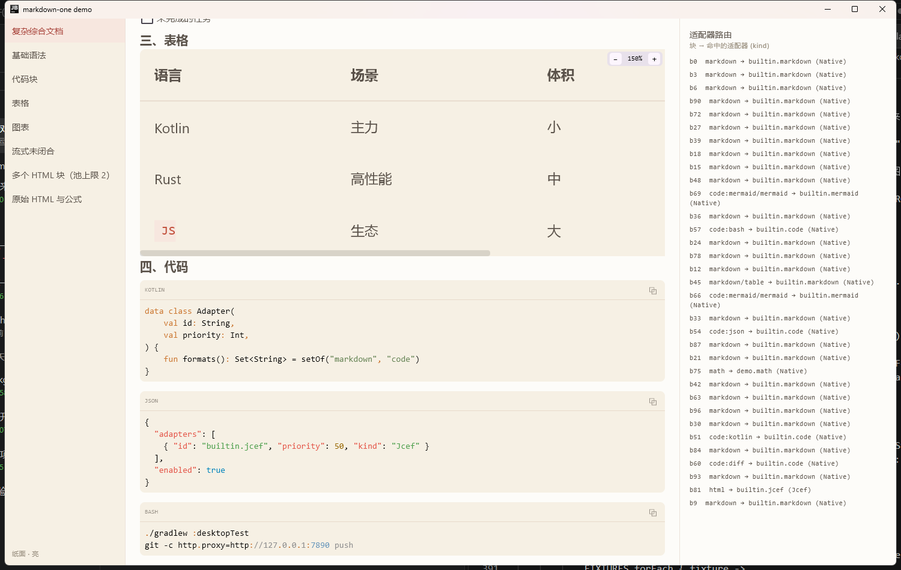

# API 参考

包名统一 `io.github.shinglem.markdown`。所有 `public` 声明都显式写了修饰符（Kotlin 2.x explicit API 风格）。

## MarkdownText

唯一渲染入口。

```kotlin
@Composable
public fun MarkdownText(
    markdown: String,
    modifier: Modifier = Modifier,
    streaming: Boolean = false,
    config: MarkdownConfig = MarkdownConfig(),
)
```

| 参数 | 说明 |
|---|---|
| `markdown` | Markdown 源码。**直接传原文**，不要预先转义或做 WYSIWYG 转换 |
| `modifier` | 作用在最外层 `Box` 上 |
| `streaming` | 流式输出中：图表只显示占位、未闭合栅栏会被补齐 |
| `config` | 见下表。`remember(config)` 会重建 registry，所以**不要每次重组都 new 一个** |

内部会自己铺整套渲染层 `CompositionLocal`（`text/` 包里的 `LocalMdColors` / `LocalMdTypography` /
`LocalMdDimens` / `LocalMdPadding`），文本与块组件全部是本库自研实现，
所以宿主不需要额外配置任何第三方 markdown renderer。

## MarkdownConfig

```kotlin
public data class MarkdownConfig(
    public val adapters: List<BlockAdapter> = emptyList(),
    public val disabledAdapterIds: Set<String> = emptySet(),
    public val allowRawHtml: Boolean = false,
    public val theme: MarkdownTheme? = null,
    public val viewport: BlockViewportConfig = BlockViewportConfig(),
    public val mermaidFallbackText: String = "图表语法暂不支持，已显示源码",
    public val mathFallbackText: String = "公式排版不可用，已显示源码",
    public val maxSyncHighlightLength: Int = 8_000,
    public val onLinkClick: (String) -> Unit = {},
    public val diagnostics: AdapterDiagnostics = AdapterDiagnostics.None,
)
```

| 字段 | 默认 | 说明 |
|---|---|---|
| `adapters` | 空 | 显式注册的适配器，优先于内置与自动发现 |
| `disabledAdapterIds` | 空 | 按 id 禁用（对**所有**来源生效） |
| `allowRawHtml` | false | 保留字段：原始 HTML 块由 `builtin.html.native` 原生渲染 |
| `theme` | null | 外观；null 表示沿用 Material 3 默认 |
| `viewport` | `BlockViewportConfig()` | 大块限高、滚动、缩放 |
| `mermaidFallbackText` | 内置文案 | 图表画不出时的提示 |
| `mathFallbackText` | 内置文案 | 公式排不出来时的提示 |
| `maxSyncHighlightLength` | 8000 | 超过这个长度的代码块跳过同步着色（避免卡 UI） |
| `onLinkClick` | 空实现 | 链接点击回调；不设则不可点击 |
| `diagnostics` | `None` | 路由与失败诊断 |


## BlockViewportConfig

大块（图表、原始 HTML、宽表格、图片）的显示策略。

```kotlin
public data class BlockViewportConfig(
    public val enabled: Boolean = true,
    public val maxHeight: Dp = 420.dp,
    public val zoomable: Boolean = true,
    public val initialZoom: Float = 1f,
    public val zoomLevels: List<Float> = listOf(
        0.4f, 0.5f, 0.6f, 0.7f, 0.8f, 0.9f, 1.0f, 1.1f, 1.25f, 1.5f, 2.0f, 2.5f,
    ),
    public val formats: Set<String> = setOf("mermaid", "html", "table", "image.generic", "footnotes"),
)
```

| 字段 | 说明 |
|---|---|
| `enabled` | 总开关 |
| `maxHeight` | 超过就出现纵向滚动条；`Dp.Unspecified` 表示不限高 |
| `zoomable` | 是否显示右上角的 `− 100% ＋` 缩放条 |
| `initialZoom` | 每块的初始缩放；`onReset` 仍回到 100% |
| `zoomLevels` | 固定档位 —— 连续 `±0.1` 会累积浮点漂移（100% 变 78%） |
| `formats` | 生效的格式前缀，按 `FormatId.value` 匹配 |

**不要往 `formats` 里加 `code`**：代码块自带横向滚动，再包一层会抛
`Horizontally scrollable component was measured with an infinity maximum width`。

表格在 150% 缩放下的样子（限高 + 底部横向滚动条 + 右上角缩放条）：



## MarkdownTheme

```kotlin
public data class MarkdownTheme(
    public val colors: MdColors,
    public val typography: MdTypography,
    public val dimens: MdDimens,
    public val padding: MdPadding,
    public val background: Color = Color.Unspecified,
)

public fun outsidePaperTheme(dark: Boolean = false): MarkdownTheme
public fun markdownMaterialTheme(): MarkdownTheme
```

四张表都是 `io.github.shinglem.markdown.text` 里的公开类型，想自定义外观就直接拼：

```kotlin
public data class MdColors(
    public val text: Color, public val codeBackground: Color, public val inlineCodeBackground: Color,
    public val highlightText: Color, public val highlightBackground: Color,
    public val dividerColor: Color, public val tableBackground: Color,
)

public data class MdTypography(   // text / code / inlineCode / h1..h6 / quote / paragraph /
    ...                           // ordered / bullet / list / table / textLink
)

public data class MdDimens(       // dividerThickness / codeBackgroundCornerSize /
    ...                           // blockQuoteThickness / tableCellPadding / tableCornerSize
)

public data class MdPadding(      // block / list / listItemTop / listItemBottom / listIndent /
    ...                           // codeBlock / blockQuote / blockQuoteText
)

// 默认值都是 Material 3（与 markdownMaterialTheme 的取值一致）
@Composable public fun mdColors(...): MdColors
@Composable public fun mdTypography(...): MdTypography
@Composable public fun mdDimens(...): MdDimens
@Composable public fun mdPadding(...): MdPadding
```

自己写适配器时可以读 `LocalMdColors` / `LocalMdTypography` / `LocalMdDimens` / `LocalMdPadding`，
保证自定义块与内置块的外观一致。

内置主题取自 typora `outside-theme` 的 **Outside Paper** 配色：暖白纸面 `#FDFCF9`、
正文 `#5A524A`、砖红强调 `#A8433A`、米黄代码块 `#F6F0E4`、行内码 `#F7E7DF`，行高统一 1.6。

想自己拼配色就直接取色板：

```kotlin
public data class PaperPalette(
    public val background: Color, public val surface: Color,
    public val text: Color, public val textMuted: Color,
    public val accent: Color, public val accentSoft: Color, public val accentWarm: Color,
    public val inlineCodeBackground: Color, public val divider: Color, public val quoteBackground: Color,
)

public val OutsidePaper: PaperPalette        // 亮
public val OutsidePaperDark: PaperPalette    // 暗
```

## MdBlock

```kotlin
public sealed interface MdBlock {
    public val key: String        // 块在文档里的标识（b0、b12…），跨文档会重复
    public val source: String     // 整篇源码：GFM AST 的 offset 是文档级的
    public val raw: String        // 该块的源码片段
    public val formats: Set<FormatId>
    public val node: ASTNode      // 原始 GFM 节点
}
```

| 类型 | 额外字段 | formats |
|---|---|---|
| `Heading` | `level: Int` | `markdown` |
| `Paragraph` | — | `markdown` |
| `CodeBlock` | `code: String`、`language: String?`、`fenced: Boolean` | `code:<lang>`，语言为 mermaid/mmd 时额外 `mermaid` |
| `Quote` | — | `markdown` |
| `ListBlock` | `ordered: Boolean` | `markdown` |
| `Table` | — | `markdown` + `table` |
| `Rule` | — | `markdown` |
| `Image` | `url: String`、`alt: String` | `image.generic` |
| `Html` | — | `html` |
| `Math` | `tex: String`、`display: Boolean` | `math` |
| `Custom` | `type: String` | 就是 `type` 本身 |

`MdDocument(blocks: List<MdBlock>, streaming: Boolean)` 是解析结果。

## FormatId / Formats

```kotlin
@JvmInline
public value class FormatId(public val value: String)   // 不能为空

public object Formats {
    public val Markdown: FormatId = FormatId("markdown")
    public val Mermaid: FormatId = FormatId("mermaid")
    public val Math: FormatId = FormatId("math")
    public val Html: FormatId = FormatId("html")
    public val Alert: FormatId = FormatId("alert")
    public val Footnotes: FormatId = FormatId("footnotes")
    public val Table: FormatId = FormatId("table")
    public val Image: FormatId = FormatId("image.generic")
    public val Any: FormatId = FormatId("*")
    public val Code: FormatId = FormatId("code:*")     // 前缀通配

    public fun code(language: String?): FormatId = FormatId("code:" + language?.trim()?.lowercase().orEmpty())
}
```

尾部 `*` 是前缀通配：`code:*` 命中 `code:kotlin`、`code:json`……

约定俗成的取值（不是枚举，可以自由扩展）：

| 值 | 含义 |
|---|---|
| `markdown` | 普通 Markdown 块（标题/段落/列表/表格/引用/分割线） |
| `code:<lang>` | 代码块，语言名小写；无语言时为 `code:` |
| `mermaid` | 图表（`code:mermaid` 的块同时声明它；PlantUML / DOT 走 `code:<lang>`） |
| `alert` | GitHub Alerts（与 `markdown` 并存） |
| `footnotes` | 脚注定义区（与 `markdown` 并存） |
| `math` | 数学公式 |
| `html` | 原始 HTML 块 |
| `table` | 表格（与 `markdown` 并存） |
| `image.generic` | 图片 |
| `*` | 通配，仅兜底适配器使用 |

## 适配器 SPI

```kotlin
public enum class AdapterKind { Native, Fallback }

public interface BlockAdapter {
    public val id: String
    public val kind: AdapterKind
    public val priority: Int
    public fun formats(): Set<FormatId>
    public fun isAvailable(): Boolean
    public fun canRender(block: MdBlock): Boolean

    @Composable
    public fun Render(block: MdBlock, modifier: Modifier)
}

public fun interface BlockAdapterFactory {
    public fun create(): List<BlockAdapter>
}

public interface AdapterDiagnostics {
    public fun onRoute(blockKey: String, formats: Set<FormatId>, adapterId: String?, kind: AdapterKind?)
    public fun onFailure(adapterId: String, blockKey: String, error: Throwable?)
    public object None : AdapterDiagnostics
}
```

优先级约定：`Native` 100 / `Fallback` 0；同优先级时**先注册者胜**。详见 [写适配器](adapters.md)。

## AdapterRegistry

```kotlin
public class AdapterRegistry(adapters: List<BlockAdapter>) {
    public val all: List<BlockAdapter>
    public fun select(block: MdBlock): BlockAdapter?
}

public fun buildAdapterRegistry(config: MarkdownConfig): AdapterRegistry
public fun builtinAdapters(config: MarkdownConfig): List<BlockAdapter>
```

`select` 返回 `null` 表示没有适配器接手（内置兜底在，正常不会发生）。
`builtinAdapters()` 可以拿来枚举内置能力，demo 的路由面板就是这么来的。

## 内置适配器

| id | kind | priority | formats |
|---|---|---|---|
| `builtin.markdown` | Native | 100 | `markdown` |
| `builtin.code` | Native | 100 | `code:*` |
| `builtin.diagram` | Native | 100 | `mermaid`、`code:*`（语言名未标记时靠内容识别） |
| `builtin.footnotes` | Native | 105 | `footnotes` |
| `builtin.html.native` | Native | 115 | `html` |
| `builtin.html` | Native | 105 | `html`（原生渲染失败时的剥壳递归兜底） |
| `builtin.math` | Native | 100 | `math`（仅 desktop） |
| `builtin.source` | Fallback | 0 | `*` |

`builtin.diagram` 与 `builtin.code` 都声明 `code:*`，由 `canRender` 里的语言判定分工：
`mermaid` / `plantuml` / `dot` / `graphviz` 走图表，其余走代码高亮；
没有任何语言标记的 fence 交给 `Diagram.detectSource` 判断内容像不像图。
画不出的图族**自己**降级成「源码 + `mermaidFallbackText` 提示」，不会路由到下一级。
