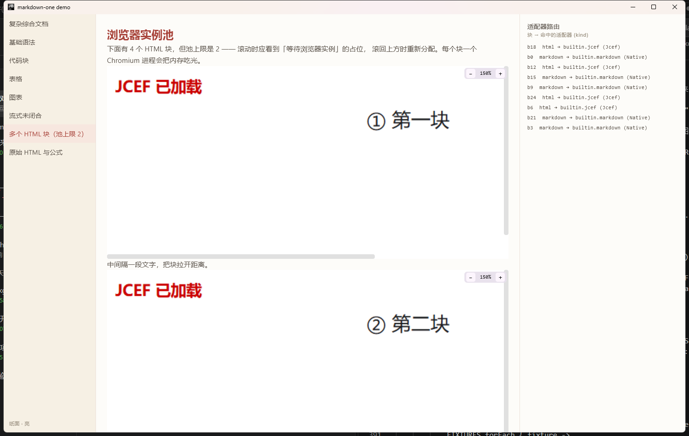

# JCEF 回落

原生画不出的内容（原始 HTML、需要 KaTeX/mermaid.js 的块）交给内嵌浏览器。
库对 `org.cef.*` **没有编译期依赖**（全程反射），所以在任何 JDK 上都能构建；
运行期找不到 `org.cef` 时自动退回源码适配器，不会崩。

```
MarkdownConfig.webFallback = WebFallback.Jcef
        │
        └─ desktopMain: platformAdapters() 注册 builtin.jcef（priority 50，kind Jcef）
                │
                ├─ isAvailable() = JcefRuntime.isPresent   ← 反射探测 org.cef
                ├─ canRender()   = webDocument(block) != null
                └─ Render()
                      ├─ JcefBudget    可见性名额（默认 2 个浏览器）
                      ├─ CefSlot       一块一个槽位，负责创建/释放/重建
                      └─ CefEngine     OSR 离屏渲染，BGRA 帧 → ImageBitmap
```

## 为什么必须离屏（OSR）

JCEF 的常规浏览器是 heavyweight AWT `Canvas`。塞进 Compose 的 `SwingPanel` 会有 z-order 问题：
canvas 盖住一切或者什么都不显示（实测两者都出现过）。OSR 模式直接回调 BGRA 帧缓冲，
我们自己画到 Compose 的 `Canvas` 上，层级与裁剪都归 Compose 管。

## 运行环境

| 要求 | 说明 |
|---|---|
| **JBR with JCEF** 或自备 CEF 运行时 | JetBrains Runtime 的 `jbrsdk_jcef-*` 版本；普通 JDK 没有 `jcef` 模块 |
| `--add-modules jcef` | 加载 JCEF 模块 |
| `--enable-native-access=jcef` | JDK 24+ 加载 native 的显式许可，将来会强制 |
| `--add-opens java.desktop/sun.awt=ALL-UNNAMED` | JCEF 内部依赖 peer 实现 |
| `--add-opens java.desktop/java.awt.peer=ALL-UNNAMED` | 同上 |

demo 里传 `-PjbrHome=<路径>` 会自动切换 JDK 并带上全部参数：

```bash
./gradlew :demo:run -PjbrHome="C:\envir\java\version\jbrsdk_jcef-25.0.4.1-windows-x64"
```

## 开关三件套

```kotlin
MarkdownConfig(
    webFallback = WebFallback.Jcef,   // 启用回落（默认 Source：只显示源码）
    allowRawHtml = true,              // 允许渲染原始 HTML 块（默认关）
    webDocument = { block ->          // 自己决定哪些块进浏览器、生成什么 HTML
        if (block is MdBlock.Math) katexPage(block.tex) else null
    },
)
```

`webDocument` 返回 `null` 表示「这个块不走回落」，交给下一级适配器。
默认实现只处理 `MdBlock.Html`（且需 `allowRawHtml = true`）—— 数学公式与图表需要
KaTeX / mermaid.js 这类脚本资源，库不打包脚本（保持零体积），由调用方注入。

## 六个静默失败的坑

每一条都对应一次「界面空白、日志无报错、什么都不发生」。全部已内置在
[`CefBootstrap.kt`](../src/desktopMain/kotlin/io/github/shinglem/markdown/web/CefBootstrap.kt)
与 [`CefEngine.kt`](../src/desktopMain/kotlin/io/github/shinglem/markdown/web/CefEngine.kt) 里，
列出来是为了排查时能对上号。

| 现象 | 原因 | 做法 |
|---|---|---|
| `CefApp.getState()` 永远停在 `NEW`，CEF 连 native 日志都不生成 | JBR 的 `getInstance()` 只是把初始化挂在一个内部 future 上，**只有 `startup()` 会完成它** | `CefApp.startup(new String[0])` **先于** `getInstance()` |
| 子进程报 `Unrecognized option: --type=gpu-process` 后退出 | CEF 默认用 `java.exe` 当子进程，把 Chromium 的开关全传给了 JVM | `settings.browser_subprocess_path = <java.home>/bin/jcef_helper.exe` |
| 第二个进程卡在 `NEW`，日志出现 `Opening in existing browser session.` | 多个进程共用默认 user data 目录，后启动的连到已有实例 | `settings.cache_path` 按 PID 隔离 |
| 浏览器占着位置但一帧都不来 | OSR 浏览器是惰性创建的，不调用就没有渲染进程 | `browser.createImmediately()` |
| 同上，且以上都做了 | `CefRenderHandler.getScreenInfo` 返回 false 或没填字段，CEF 认为没有可用屏幕 | **填充 `CefScreenInfo` 全部字段并返回 true** |
| 反射调用抛 `IllegalAccessException` | 用了实现类 `CefBrowser_N`（`public` 但在 jcef 模块里不可访问） | 方法一律从 **`CefBrowser` 接口**上取 |

还有一条只在「文档里第一个浏览器」上出现的：

> **首个 `CefBrowser` 上「创建后再 `loadURL`」会丢。** 表现是第一个块永远全白，后面的块正常。
> 内容必须作为**初始 URL** 传给 `CefBrowserOsrWithHandler` 的构造函数，
> 见 `CefEngine.dataUrl()` 与 `CefSlot.request()`。

## 生命周期

### 一块一个引擎，不做轮转复用

把同一个 `CefBrowser` 交给不同块（切帧回调 + 反复 `loadURL`）在 native 层会直接崩：
`exit 0x80000003`（`STATUS_BREAKPOINT`），没有 Java 堆栈。所以每个块独占自己的浏览器，
靠**可见性驱动的名额分配**把常驻进程数压下来。

### 名额按可见性分配

每个 `CefBrowser` 是独立的 Chromium 渲染进程（单实例就有 5+ 个子进程），全文档一块一个会吃光内存。

```kotlin
MarkdownConfig(jcefPoolSize = 2)   // 同时存活的浏览器上限
```

分配逻辑在 [`JcefBudget`](../src/desktopMain/kotlin/io/github/shinglem/markdown/web/JcefBudget.kt)：

1. 每个 JCEF 块在 `onGloballyPositioned` 里上报自己到**视口中心**的距离（含半屏预取 margin）；
2. 池子按「已持有 → 距离近」排序，取前 `jcefPoolSize` 个；
3. 没拿到的块显示「等待浏览器实例」，滚进来时自动接手；
4. 滚出去的块归还名额并释放引擎（`CefSlot.releaseEngine()`），进程立刻退出。

为什么不是先到先得：第一帧所有块同时申请，离屏的块会占着名额不放，
屏幕上真正可见的块反而一直显示占位（实测复现过）。
未测量（bounds 全零）的预加载项不上报，否则它会以「距离 0」抢走名额。

### 关闭顺序

- `releaseEngine()` —— 临时释放（名额被别人拿走），之后还能重建；
- `dispose()` —— 永久销毁（块离开组合），之后不再创建。

两者都区分「已建好」与「创建中」：创建期间被释放时，用 `wanted` 标记让刚建好的引擎自己销毁，
否则会泄漏一个 Chromium 进程；反之如果创建完又变回需要，就保留它（不然没有触发点会永远空白）。

`CefEngine.dispose()` 里的 `close`/`dispose` 会**等 CEF UI 线程**，必须在后台线程调用 ——
主线程调用会让窗口根本出不来。

## 有界高度

OSR 先有尺寸才出帧，所以 JCEF 块必须给定高度：

```kotlin
MarkdownConfig(
    webFallbackHeight = 320.dp,                              // 块高
    viewport = BlockViewportConfig(maxHeight = 420.dp),      // 视口再限一次 + 滚动条
)
```

内容超出时在**页面内部**滚动（`getViewRect` 用视口尺寸），视口再负责缩放与滚动条。

## 安全

- `allowRawHtml` **默认关**：LLM 输出里的 HTML 直接进浏览器等于给它一个渲染沙箱。
- **网络请求白名单需要自己加**：`` 是追踪像素，
  本库尚未内置请求拦截（`CefRequestHandler`）。要拦的话在 `CefEngine` 创建 client 时挂一个
  `CefRequestHandler` 代理，只在 `onBeforeResourceLoad` 里放行白名单域。

## 诊断

`JCEF` 适配器失败会走 `AdapterDiagnostics.onFailure(id, blockKey, error)`；
路由结果走 `onRoute(...)`，`kind` 为 `Jcef` 的条目一眼可见。

demo 的右侧面板就是这套诊断的渲染：



上图中 4 个 HTML 块、池上限 2，①② 显示内容，③④ 显示占位；同时可以看到 150% 缩放下的
竖向与横向滚动条。
